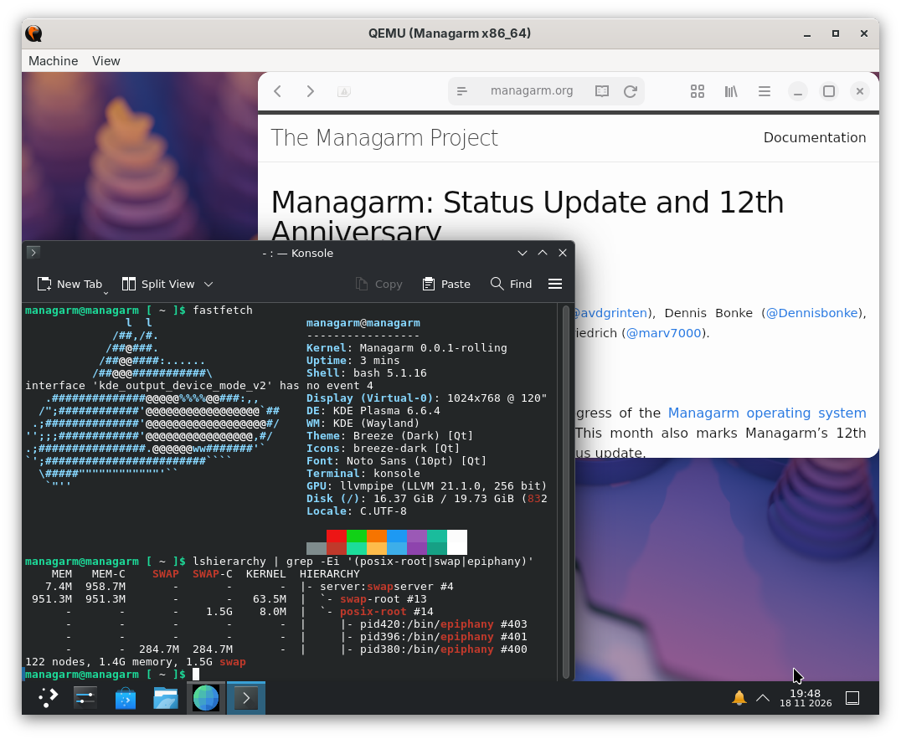

Post written by [@48cf](https://github.com/48cf) and Alexander van der Grinten ([@avdgrinten](https://github.com/avdgrinten)).

## Introduction

In [our previous post](https://managarm.org/2026/08/19/0-anon-swap.html), we presented the kernel's ability to swap out anonymous memory, with the caveat that only shared mappings could be swapped. However, most memory handed out to POSIX applications, including stacks and private heap allocations, is copy-on-write, so in practice little of it could actually be swapped out. We also could not exercise the swap-out path outside of the kernel test suite, since there was no userspace server to handle swap requests. Both limitations are now gone: we merged support for swapping copy-on-write memory ([#1630](https://github.com/managarm/managarm/pull/1630)), a swap server ([#1716](https://github.com/managarm/managarm/pull/1716), [#1720](https://github.com/managarm/managarm/pull/1720)) and support for swapping to regular files ([#1724](https://github.com/managarm/managarm/pull/1724)).

## Swapping copy-on-write memory

Managarm's kernel has always supported copy-on-write memory to allow userspace to efficiently implement POSIX semantics (such as `fork()`) for applications. In the kernel, a copy-on-write memory object is a sparse collection of `CowPage` structs that store metadata about each page. Before we added the ability to swap copy-on-write pages, a `CowPage` simply pointed to the physical address of the page. We made these pages swappable by adding a level of indirection: instead of pointing directly to the physical page frame, a `CowPage` now points to a page inside a swap space (see our previous post for an explanation of swap spaces).

This indirection made swapping fairly straightforward to implement. The two main operations that a memory object in Managarm's kernel needs to support are `peekRange()`, which resolves an offset to a present physical page (failing if no page is present at that offset), and `touchRange()`, which ensures that a page is present at a given offset. To make copy-on-write pages swappable, we chain the copy-on-write implementations of these functions with operations on the swap space. `peekRange()` now first resolves to a page inside the swap space and then calls a new `getResident()` function that determines whether the page is currently present (i.e., not swapped out). `touchRange()` on a shared page performs the private copy needed for the copy-on-write mechanism as before; however, it can now also hit the case in which the private copy already exists but has been swapped out. In this case, `touchRange()` calls a new `ensureResident()` function that brings the page back from swap.

Aside from these basic operations, some care has to be taken to ensure correct semantics for more niche operations. For example, locking a `CowPage` in place propagates to a lock on the underlying page in the swap space, so that the page cannot be swapped out and brought back into RAM at a different physical address. This is necessary to ensure correct behavior of device DMA on copy-on-write memory objects.

## The userspace server

Managarm's kernel only provides the mechanism for swapping, not the policy. Hence, in addition to the kernel, several servers are involved in swapping memory. A central component is the new _swapserver_, which is launched from Managarm's initrd. The POSIX server connects to swapserver, which in turn hands out a swap space to the POSIX server. This allows the latter to allocate swappable memory objects for POSIX applications.

For the actual I/O, swapserver cooperates with disk drivers (which are separate servers). Disk drivers publish _swap targets_, which can be either swap partitions or swap files. In our initial implementation, we recognize swap partitions by a GPT partition type GUID that we picked at random for Managarm swap partitions. Once swapserver has enumerated a swap target, it sets a swap budget, that is, the number of swapped-out pages that the swap target can hold. Afterwards, swapserver processes swap-out and swap-in requests from the kernel and forwards them to the swap target (i.e., the disk driver).

In the case of a swap partition, the disk driver simply writes directly to the partition. For swap files, the disk driver bypasses its page cache, as caching swapped-out pages would be counterproductive when the system is under memory pressure. Instead, it uses its usual file system code to resolve offsets within the swap file to on-disk locations, but then writes directly to the disk. Since swap files can be written by normal file system operations before they become swap targets, this scheme requires flushing the file's page cache when swap is turned on.

## Demo

The screenshot below shows Managarm running KDE Plasma in a QEMU virtual machine with 2 GiB of RAM, while Epiphany displays our website. According to `lshierarchy`, 1.5 GiB of swappable memory is charged to `posix-root`, the hierarchy node that contains all POSIX applications. However, only 951.3 MiB of physical memory is _actually_ allocated by swapserver, which means that roughly 600 MiB of memory is currently swapped out. Without swap, the same workload runs out of memory.

## What's next

This work concludes our effort to implement swapping in Managarm. As mentioned in [our October status update](https://managarm.org/2026/10/18/oct-update.html), we also made good progress on out-of-memory handling and memory accounting, and most of the memory management tasks that we promised as part of our NLnet grant are now done. One of the areas that will receive attention soon is our virtualization stack: we have already overhauled our virtualization code on x86_64 and we plan to upstream support for KVM in Managarm in the next few weeks.

## Supported by NLnet

[This project](https://nlnet.nl/project/Managarm/) was funded through the [NGI0 Commons Fund](https://nlnet.nl/commonsfund/), a fund established by [NLnet](https://nlnet.nl) with financial support from the European Commission’s Next Generation Internet programme, under the aegis of DG Communications Networks, Content and Technology under grant agreement No 101135429. Additional funding is made available by the Swiss State Secretariat for Education, Research and Innovation (SERI).

## Talk to us

We welcome contributions to Managarm! If you want to help out, feel free to look at [our issue tracker](https://github.com/managarm/managarm/issues), or chat with us on [Discord](https://discord.gg/7WB6Ur3) or IRC in `#managarm` on `irc.libera.chat` about ideas.
